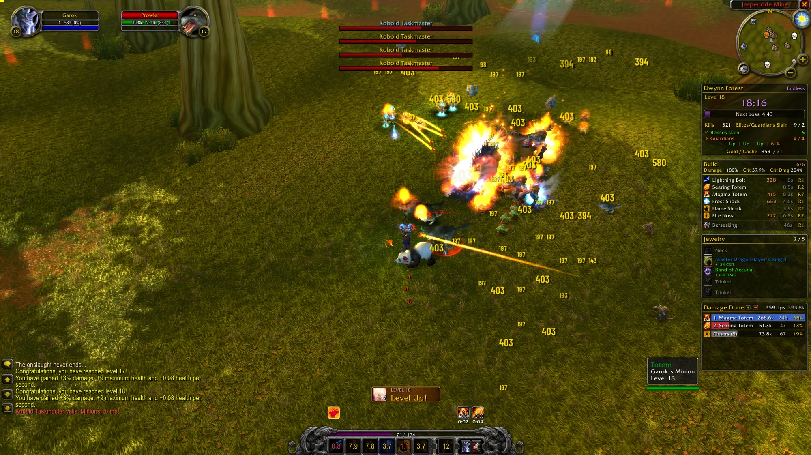
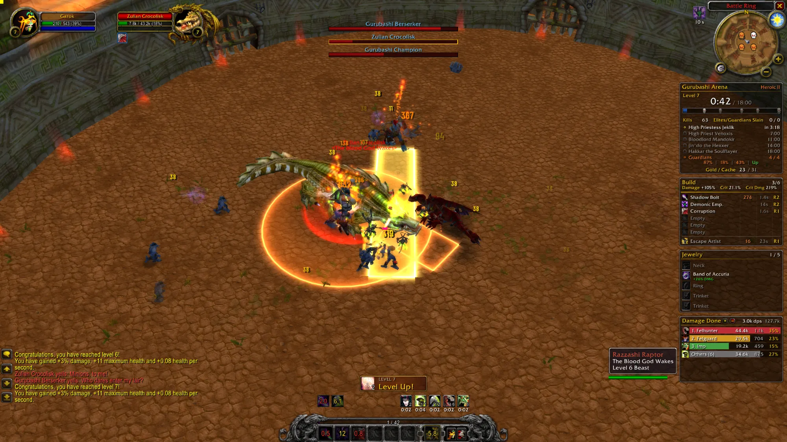
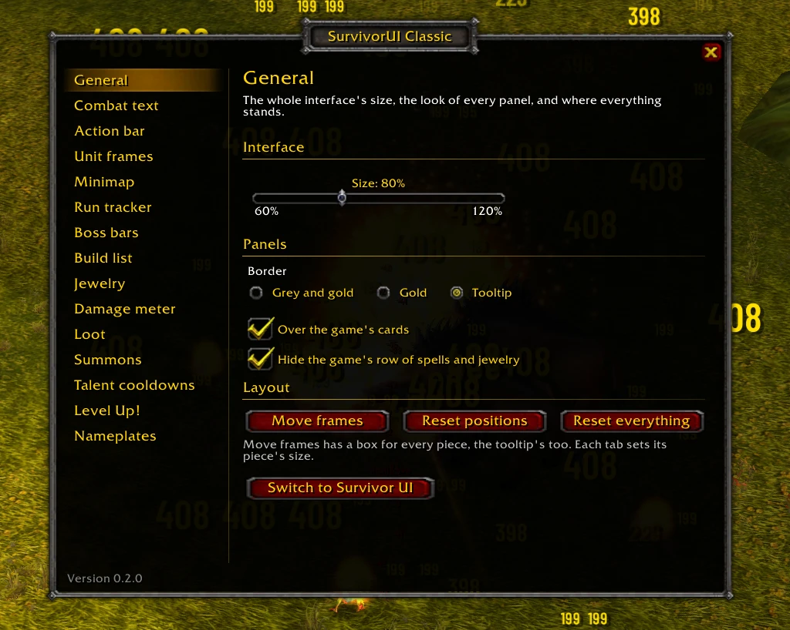
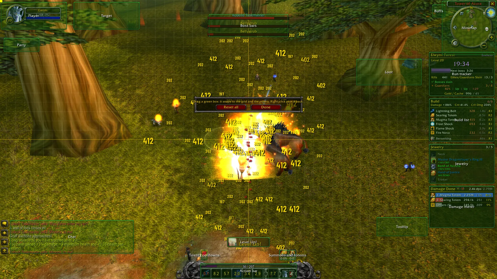

# SurvivorUI Classic

The game's own interface for Azeroth Survivors, with a few things more, in the game's own look.

SurvivorUI Classic is a branch of [Survivor UI](https://github.com/morderous/survivor-ui), by the same author: much of the same logic, in the game's own look instead of Survivor UI's. It works on its own: neither addon needs the other. Install the one you like, or both and choose.

What it gives:

- **Everything movable and sized.**
  - Left-click the gear on the minimap for the options. Right-click it for **Move frames**: every piece gets a green box. Drag a box to move its piece; right-click it to put the piece back.
  - Move frames covers the minimap, the player, target and party frames, the action bar with its experience bar, the buffs, the chat, the tooltip and the addon's own pieces.
  - While the boxes are up, a grid shows, its middle lines in gold. A box let go snaps to the grid, to the screen's edges and middle, and to the other boxes' edges and middles.
  - A place is kept from the point of the screen nearest the piece, so the layout keeps its shape at any interface size and any resolution: a piece in the middle stays in the middle, one by an edge stays by that edge.
  - The options give each piece its own size, and it grows from where it stands. The whole interface is at 80%, its size a slider in General.
- **The Guide.** A gold ! on the minimap's rim opens pages that explain the game's numbers simply, with colors, sliders to try and your own hero's numbers: Luck, Damage, Crit, DoTs, the spells that look like DoTs and aren't, and Damage Reduction. Everything in it was read from the game's executable, and more pages are coming.
- **Health and mana in numbers.** The target frame shows an enemy's real health, `12.3k / 40.0k (31%)`, read from the game, and the mana in the same words. Each frame can show Off, Value, Percent or Both.
- **Run tracker,** after a Mythic+ timer, in a panel as the others:
  - the zone, with its Heroic level or Endless;
  - your level and the lives left, from Heroic III on the run's affixes, the time in the middle against the final boss's second, and the run's bar with a skull for every boss;
  - the kills, and the elites and guardians slain;
  - the objectives: each boss with a check and the second it fell, its health while it is up (click to target it), and the next one's countdown; in endless mode, the next boss and the bosses slain;
  - the guardians holding their lairs, in red when all are slain, green while some hold, orange while one fights, and the second each empty lair fills again (hover for every lair);
  - your gold against the next cache's price, in the middle.
  - What is done turns green.
- **Boss bars.** The game's own as they look, the name in red over a long thin red bar, with two things more: they move, and a click targets the enemy (the one you target is framed in gold; hover for its health). The bar under the mouse goes white and lines its enemy's plate in white, and a bar goes white with the mouse on its enemy in the world. The lair guardians and elites too, as you choose.
- **Cooldown numbers** on the action buttons, down to the tenth of a second, the button darkened while it cools down.
- **Summons and totems** as the game's buffs, over the action bar's right end and growing toward its middle: how many are out ("6/30" against a limit) and the time the first goes.
- **Talent cooldowns** over the action bar's left end, growing toward its middle: a second life's wait (Divine Intervention, Cheat Death), a heal's, a proc's, a summoning talent's next; dark and counting while they wait, glowing gold when ready.
- **Caches and lairs on the minimap**: loot bags for every cache, a skull for every guardian's lair (beating while it fights, faint with a green check while empty), in place of the game's one flag.
- **The character page in one panel**, in the look of the others: the item slots at both sides, the hero between them, turned by holding the mouse on it and pulling, at the hero's left the odds your luck gives on the cards and the necks, at the right Damage, Crit and Crit Dmg, each hovered for its formula with your numbers in it, and under the hero the other numbers in four small panels by kind (Bonus, Utility, Defense, Offense), the game's Run Stats box folded in. The hero's name in the class's color. The options' Character panel tab picks this page or the game's own, no changes.
- **Loot notices** and the **Level Up! button**, as the game's but movable, the button with its key on it.
- **Frames a second** in the screen's bottom left corner, and **a border round the game's clock** under the minimap. Hover it for your choices: your computer's time or any time zone, 24 or 12 hours.
- **The whole interface's size**, in the options' General tab.
- **Damage meter.** Damage done, damage a second, healing, the last boss fight or the party, with each spell's icon, its number and share; the lines under 10% folded into Others (the button by its title), Reset to count Damage Done and DPS from now on (the arrow beside it), as tall as the lines you set, a scroll bar for the rest, in the font size you set.
- **Build list.** Your Damage, Crit and Crit Dmg in its title; your six spell slots, filled or empty, by rank, the highest first, with each spell's biggest crit this run, its cooldown and its rank, and your racial apart. Hover a biggest crit for that spell's crits and hits this run.
- **Jewelry.** The neck, rings and trinkets you wear this run, and what each one gives.
- **Combat text in Barlow.** The damage you deal and the damage you take, in Barlow Condensed, each at 30 to 100% of its size, or turned off altogether.
- **Nameplates** on: V shows or hides the enemies', Shift-V the friends'. The options can show only your target's, or only the bosses', guardians' and elites' (your target's always).

The run tracker, build list, jewelry and damage meter stand one under the other in a column under the minimap, all of the same width, made to fit the screen: the damage meter shows the lines that fit above its bottom edge. Move one and it stands on its own. The build list, jewelry and damage meter are panels of the same make: a dark ground, its border, its title in gold over a gold rule.

The run tracker, boss bars and damage meter stand in for the game's own clock with its kills and gold line, boss bars and meter. The game's row of spells and jewelry under the chat can be put away. Each comes back when you turn the addon's piece off or remove the addon.

As it first opens, the same for everyone: the column under the minimap, the action bar at 85% in the bottom middle, the talent cooldowns and the summons side by side over it, the Level Up! button above them, the boss bars at the top middle, the tooltip just left of the column, the tooltip's border on every panel, seven lines in the damage meter, and the combat text at 40% (the damage you deal) and 30% (the damage you take).

The interface is as tall in its own units at any resolution, so this layout looks the same at 1080p, 1440p or 4K. A wider or narrower screen only gives more or less room between the pieces held by the sides and the ones in the middle; on a 5:4 screen the chat is a little narrower, to stay clear of the talent cooldowns.

The border is yours to choose: grey and gold, gold, or the tooltip's. The run tracker, build list, jewelry and damage meter can stay over the game's level-up and jewelry cards, so you see them while you choose.

## Screenshots

| | |
|---|---|
|  |  |
| A Heroic II run: the run tracker with its bosses and guardians, the build list, the jewelry and the damage meter under the minimap; the boss bars at the top; the summons and talent cooldowns over the action bar. | The options, a tab for each piece. |
|  |  |
| Move frames: a green box for every piece, the grid and its middle lines. | An endless run: the next boss counting down in the purple bar. |

## Install

Two ways, the same result: the launcher, or the zip by hand.

### With the launcher (easiest)

1. Download `SurvivorUI-Installer.zip` from the [latest release](https://github.com/morderous/survivorui-classic/releases/latest) and unzip it. It is the [Survivor UI launcher](https://github.com/morderous/survivor-ui#with-the-launcher-easiest), the same in both repositories.
2. Open `SurvivorInstaller.exe`. Windows may say it protected your PC, since the program is new and not signed: click **More info**, then **Run anyway**.
3. The launcher finds the game by itself, or click **Find game...** and pick `AzerothSurvivors.exe`.
4. On a PC with no launcher before it, the launcher installs SurvivorUI Classic and Survivor UI by itself once the game is there, and the game asks which of the two to use. If you already have a launcher, in the **Addons** tab pick **SurvivorUI Classic** and click **Install**.
5. A new version comes by itself once the game is closed, unless you untick **Auto Update when ready** on its row.

### By hand

1. Download `SurvivorUIClassic-X.Y.Z.zip` from the [latest release](https://github.com/morderous/survivorui-classic/releases/latest).
2. Unzip it into the game's addon folder, `benilla-config\AddOns\`. You should end up with `AddOns\SurvivorUIClassic`.
3. Restart the game.

To remove it, delete its folder: the game's own screens come back as they were.

## Survivor UI and SurvivorUI Classic

SurvivorUI Classic is a branch of Survivor UI, and each works on its own: you need only one of them installed. They change the same frames, so when both are installed only one of them runs: a panel asks which one you want. To switch later, use **Change UI**, the button under the options' tabs (or `/suic` while Survivor UI is in use), then close the game and open it again. Survivor UI 3.0.44 or newer steps aside by itself when SurvivorUI Classic is chosen; with an older one, the panel asks you to update it, or to keep Survivor UI.

## Commands

- `/suic`: the options, or the choice panel while Survivor UI is in use.
- `/suic move`: Move frames.
- `/suic reset`: every frame back in its first place.

## Changes

### 0.2.7, 2026-11-01

A switch for the cooldown text, exact crits on the build list, a damage meter that scrolls and a clock your way.

**New**
- **Cooldown text is your choice:** **Cooldown text on the action bar**, in the options' Action bar tab, turns the numbers on the buttons on or off, with the dark over them.
- **The damage meter scrolls:** with more to show than the lines you set, a scroll bar comes up at its right: drag it, click it or use the wheel, so the meter can stay short. Only the small lines fold into Others now: the rest no longer go there for lack of room.
- **Your time, your way:** hover the clock under the minimap to see what a click does: it opens the options' Minimap tab, with **Your computer's time** to tick, or untick for a slider to any time zone you want, and **24-hour clock** to tick for 24 hours or untick for 12. The game's clock has neither, so a clock of this addon takes its place, in the same spot, only when you ask for what it cannot show.

**The game's new data**
- **Each hit where it belongs** (the game's 0.139): the game now says which meter line each hit counts toward, so a proc that borrows a spell, like Flametongue Weapon's Fire Nova, no longer adds to that spell's crits on the build list, and Survivor UI's numbers name it right.
- **Talent icons in every language:** with the game in another language, a talent's line on the damage meter shows its icon and its tag.
- **The minimap's pins follow you live** (the game's 0.132), in dungeons and raids too. They used to jump about once a second.
- **The new Enhancement Shaman** (the game's 0.134 to 0.137): the new talents and Rockbiter Weapon have their icons, and Call of Flame is out, as the Shaman no longer has that spell.

**The Guide**
- **A word from the Guide:** the first time you play with this version, a small card beside the Guide's button says it is there. It shows once, and never again.
- **The Guide's Reduction page:** Stormguard, the new Shaman talent, joins the talents that add to the number, with its tooltip.
- **The Guide's buttons:** the page's number beside the title, Previous and Next at the foot of the page, and a Close button of its own color in the bottom right corner, in a slightly taller window.
- **The Guide's chips:** a chip could lose its class's color and show only the border, as the Paladin's did.

**Fixed**
- **The clock's border goes with the clock:** closed with its X, the minimap left the border alone on the screen, and it now goes too when you turn the clock off in the game's options (its 0.136, Show Local Clock).
- **From Survivor UI to this addon, the game's clock comes back:** Survivor UI puts it away for its own.

### 0.2.6, 2026-10-31

**Introducing the Guide.** A new button on the minimap opens a window of pages that explain how the game's numbers really work, in plain words, with colors, sliders to try and your own hero's numbers. Every number in it was read from the game's executable (game version 0.131). It's an ongoing project: more pages are coming, and feedback is welcome.

**The Guide**
- **The button:** on the minimap's rim, in our own art: a gold ! while there is a page to read, a ? once all are read. Hide it on the options' Minimap tab; `/suic guide` opens the Guide too.
- **Luck:** the bag of marbles, the magic number, and sliders for Luck and level that fill a bag of 100 marbles.
- **Damage:** the four boxes of a hit, what is added and what multiplies, and where buffs like Battle Shout go, each with its tooltip.
- **Crit:** why Crit stops at 100%, where the rest goes, and three cards that show which +10 is worth most for your hero right now.
- **DoTs:** a clear warning that Crit and Crit Dmg do nothing for them, when a DoT's damage is set, how copies grow with your level, and marbles for the ticks.
- **Not DoTs:** the spells that look like DoTs and aren't, one by one with a tooltip: Consecration, Flamestrike, Blizzard, Rain of Fire, Hurricane, Volley, the traps and Hellfire. They crit, and two on the ground at once both count.
- **Reduction:** how Damage Reduction works, its 60% cap, the talents that touch the cap, the talents of every class that add to the number, each on its class's color with a tooltip, and a bar to try it on.

**Also new**
- **Character panel tab** in the options: use the old page, no changes, or ours. It moved here from General, and with the old one chosen the hero no longer turns by dragging.
- **Build list:** the spells stand by rank, the highest first.

### 0.2.5, 2026-10-31

**A very classy new character panel.** The character page is rebuilt from the ground up, and the rest of the interface gets a long list of small comforts.

**The character panel**
- **One panel for everything:** a wider window in the look of the other panels, the hero in the middle, the item slots at both sides. The game's Run Stats box is folded in, so every number lives in one place. The Character, Skills and Honor tabs and the ammo slot are gone.
- **Turn your hero:** hold the mouse on the hero and pull. This works on the game's own page too.
- **Main stats:** Damage in green, Crit Dmg and Crit in orange, since those two work as a pair. Hover one for its formula, read from the game's code, with your own numbers in it: what your level, gear and the rest add, your average hit, and what your damage, crits and haste give together.
- **Luck:** your odds of a legendary (orange), epic (purple) or rare (blue) on Cards (spell cards, rings and trinkets) and on Neck (amulets). Hover it for the whole roll: each rarity's weight and share, what amulets, hoards and bosses add, and your odds of a legendary among a level-up's 3 cards.
- **Four small panels** under the hero, by kind: Bonus, Utility, Defense and Offense, with the game's own numbers and tooltips. Haste shows its formula on its tooltip, and Armor now reads Dmg Reduction, first in Defense.
- **Your name in your class's color,** a shaman's blue, in the damage meter too, and **a new ring round the portrait,** our own art, sharp at any size.
- **The character page in one panel**, on the options' General tab, brings the game's own page back.

**Combat**
- **Survivor UI's combat numbers, as an option:** on the options' Combat text tab, Use them in place of the game's numbers puts columns by your hero: damage on the left, crits on the right, healing over the hero and damage you take under it, each moved with Move frames. Hits close together add up (x3), and each number can wear its spell's icon and the damage meter's color. Off by default.
- **Damage meter:** clearer letters, white in Barlow with an outline, and a name stays on one line, cut short where it must be. Damage Done shows each line's total and share, with the whole total in its title, the number its lines add up to. DPS shows the damage a second and the share.
- **Each spell's crits and hits:** hover a biggest crit in the build list for that spell's crits this run (the biggest, when it was last beaten, the last, the average, the smallest), its normal hits and its crit rate.
- **Which boss is which:** the boss bar under the mouse goes white and lines its enemy's plate in white. With the mouse on an enemy in the world, its bar goes white too.
- **Pets with an icon:** the damage meter's Pets line, a hunter's beasts added up by the game, has Call Pet's icon, and Survivor UI's numbers use the same name, color and icon.

**Around the screen**
- **Level Up! button:** higher, at about the height of the damage meter's title, gone altogether while the cards are up, and with its key in a key cap at its right.
- **Frames a second:** in the screen's bottom left corner, green from 60, gold from 30, red under. Movable, and on the options' General tab to turn off.
- **A border round the game's clock:** the panels' border, at the clock's size on any screen. **A border round the clock**, on the options' Minimap tab, takes it off.
- **Mana in the same words as health** on the unit frames: `100 / 100 (100%)`, in the same font and size.
- **Overlapping plates:** the game's new Nameplate Layout (its 0.131) is set to Overlapping once for everyone, so each plate stays right over its enemy. **Overlapping plates**, on the options' Nameplates tab, turns it back to Stacking.
- **The summons' count over the icon:** how many summons or totems are out ("4/30") now sits above the icon, with the time under it.

### 0.2.4, 2026-10-30

- **Combat text off:** Show the combat text, on the options' Combat text tab, turns it all off at once: the numbers and words over the enemies and everything over your hero. It keeps from one game to the next.

### 0.2.3, 2026-10-30

- **Restart game:** with the Survivor UI launcher open (1.7.1 or newer), Quit game in the Change UI panel becomes Restart game: the game closes and the launcher opens it again by itself. Without the launcher it stays Quit game.
- **Nothing through the level's cards:** the action bar, the summons and the talent cooldowns fade while the cards are up, as the game could draw an icon of theirs over a card (seen with Survivor UI).
- **Change UI:** a button under the options' tabs, there on every tab, in place of Switch to Survivor UI on the General tab, opens the panel that picks the interface. With Survivor UI turned off in the game's Options, AddOns tab the button still shows, and the panel says where to turn it on.
- **The chat's place through a change of interface:** the game keeps one place and size for the chat, so Survivor UI's stayed on after coming back. SurvivorUI Classic now keeps its own and puts them back as it starts; with none kept yet and the chat where Survivor UI left it, the chat goes back to the game's first place.
- **Reset on the damage meter:** the arrow beside the fold button starts Damage Done and DPS over from that moment, each spell's damage, damage a second and share counted from there, as Survivor UI's Reset. The Healing, Boss Damage and Party pages stay the game's. A new run starts the meter over by itself.

### 0.2.2, 2026-10-29

- **The minimap's pins in the browser** (reported on Discord for Survivor UI by kemot, Fulger and Floowi): the cache bags and the lairs' skulls were missing in the game played in a browser (Chrome, Brave) and in the macOS port, which read no TGA. Each picture now comes as a BLP too, the game's own format, which every version of the game reads first. In the Windows game nothing changes: the same pixels.

### 0.2.1, 2026-10-29
- **The chat clear of the talent cooldowns on a 5:4 screen** (1280x1024): there the chat's long lines reached under the talents' row at the action bar's left end, so the chat is made narrower to end before the bar's art. On 4:3 and wider nothing changes, and the chat gets its own width back on a wider screen and as the game closes, so it is never saved narrowed. A chat moved in Move frames is left as it is.
- **The launcher in every release**: `SurvivorUI-Installer.zip`, the Survivor UI launcher, which installs and updates SurvivorUI Classic from its Addons tab.

### 0.2.0, 2026-10-29
- **Options:** a window in the game's look, with a tab for each piece: its size, what it shows, and Reset. Tabs: General, Action bar, Unit frames, Minimap, Run tracker, Boss bars, Build list, Jewelry and Damage meter.
- **Run tracker:** replaces the run frame, after a Mythic+ timer, with the bosses' checklist and the guardians, elites, kills, gold and next cache. The game's kills and gold line is put away.
- **A column under the minimap:** the run tracker, build list, jewelry and damage meter, one under the other, all 230 wide, made to fit the screen.
- **One look:** every piece a panel with a dark ground, a border and a gold title over a gold rule.
- **Boss bars:** the game's own look, moved and targeted; the lair guardians and elites too.
- **Damage meter:** flat bars with room between them.
- **Damage meter:** new, in place of the game's.
- **Combat text:** the damage you deal and the damage you take in Barlow, each at 30 to 100% (the options' Combat text tab); the damage you deal from the next time the game opens (the game reads its font once, as it loads). With Survivor UI standing aside, the game's numbers are turned back on (Survivor UI turns them off for its own).
- **Cooldown numbers:** on the action buttons, down to 0.1 second, the last two seconds in red.
- **The game's screens given back:** the game saves its settings a second after each change, and closing it, what was put away stays away. So the screens put away are kept in the addon's settings: with Survivor UI chosen in its place, they come back as the game starts. With Survivor UI standing aside, the game's screens the addon has none of its own for (the Level Up! button, the loot notices, the minimap's flag, the revive bar, the banners) come back too.
- **Jewelry:** what each piece gives in a smaller font.
- **Run tracker:** Elites/Guardians Slain; the guardians' lairs, their state in color and each empty one's seconds to fill again; a thicker run's bar.
- **Damage meter:** bigger texts on taller bars.
- **Interface size:** a slider for the whole interface, in General, at 80% for everyone.
- **Move frames:** a grid, and snapping to it, to the screen's edges and middle and to the other pieces. Places are kept from the screen's nearest point (an older version's are kept again so as they first open, the action bar back in the middle).
- **Jewelry:** what a piece gives just under its name.
- **Run tracker in endless mode:** the run's bar counts down to the next boss, "Next boss 4:50" in it; the list is the bosses slain alone; the clock in purple.
- **Boss bars:** every boss, and at most four guardians and elites.
- **Damage meter:** Others (the small lines folded, a button and an option, as Survivor UI's), (neck) on a neck's own damage, as tall as the lines set.
- **Cooldown numbers:** a quarter bigger and brighter.
- **New:** the summons and totems, the talent cooldowns, the caches and lairs on the minimap, the loot notices, a movable Level Up! button.
- **Build list:** Damage, Crit and Crit Dmg in its title; each spell's biggest crit this run (read off the combat log); ranks as R1.
- **Damage meter:** every source's icon (pets, weapons, talents, items), as Survivor UI's.
- **Cooldown numbers:** yellow, red at the end.
- **Health text:** smaller, and smaller still until it fits inside the bar.
- **Tooltip:** movable, with Move frames.
- **The game's row of spells and jewelry** under the chat can be put away (on by default).
- **Panels:** one border for all of them: grey and gold, gold, or the tooltip's.
- **Minimap button:** left-click for the options, right-click for Move frames.
- **First layout:** the one above, for everyone: the action bar at 85%, the tooltip left of the column, the tooltip's border, seven meter lines, combat text at 40% and 30%. Reset puts a piece back there.
- **Nameplates:** on with this interface; V for the enemies', Shift-V for the friends' (the game's Level Up! key goes back to Y), and a Nameplates tab: only your target's, or only the bosses', guardians' and elites'.
- **Damage meter:** a DPS page; a font size, 8 to 14; the numbers in three columns, centered.
- **Run tracker:** the run's affixes from Heroic III; each lair's line under the guardians, Up, its health in a fight, or its seconds to fill again.
- **Build list:** a column for each number, centered, with faint lines between; long names cut ("Demonic Emp.").
- **Jewelry:** each name on one line, a class amulet's by its spell alone.
- **Minimap:** the caches as loot bags, the lairs as skulls; an empty lair's skull faint with a green check.
- **Talent cooldowns and summons:** side by side over the action bar, the talents' at its left, the summons' at its right, each growing toward the middle.

### 0.1.0, 2026-10-29
- First version: the choice panel with Survivor UI, Move frames, health text on the player and target frames, the run frame, boss bars, the build list and the jewelry worn.

## License

GPL-3.0. Some of the logic comes from [Survivor UI](https://github.com/morderous/survivor-ui), by the same author. The Barlow fonts are under the SIL Open Font License 1.1 (`SurvivorUIClassic/Fonts`).
